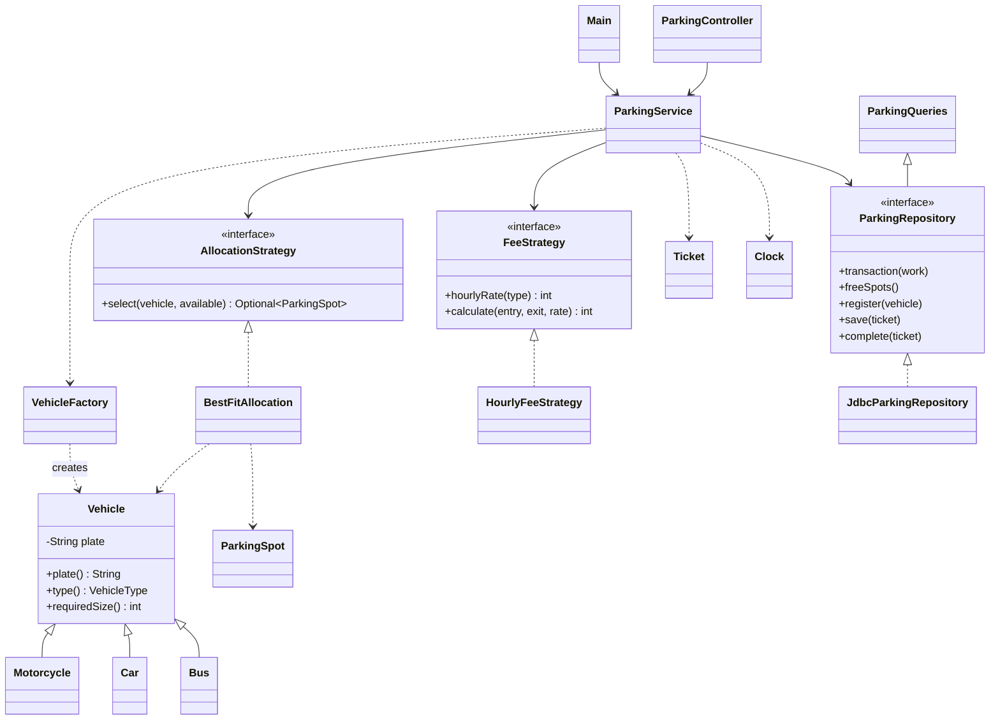
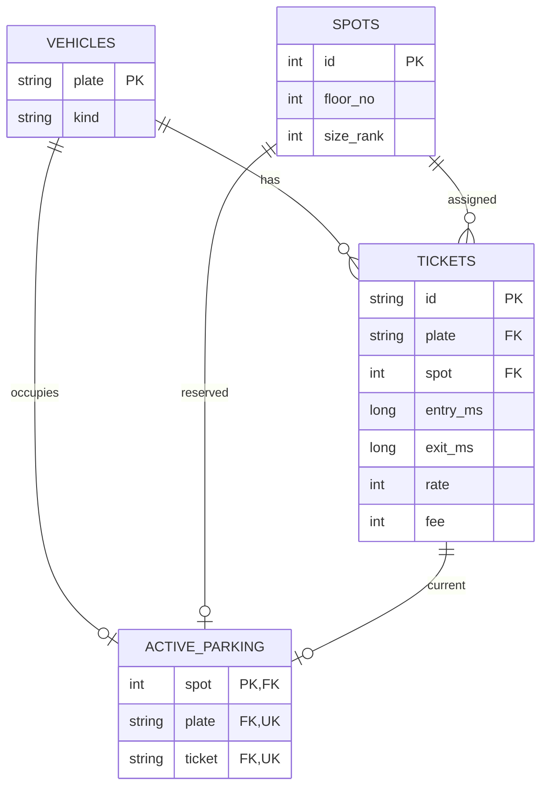
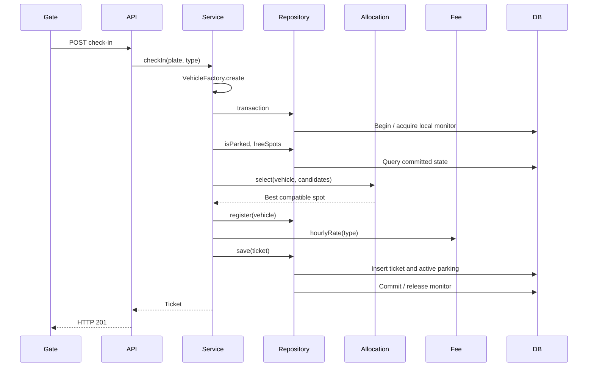
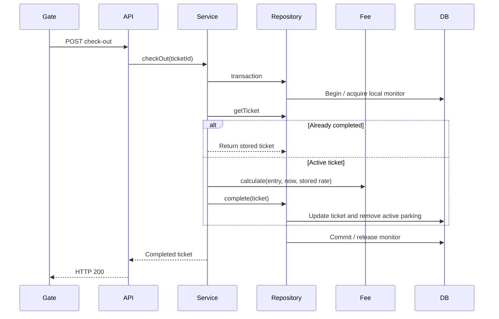

# Low-level design

## Architecture and class relationships
The core is framework-independent. Both HTTP adapters compose the same service with a JDBC repository, allocation strategy, fee strategy and clock. The default application is a single-process local server; the optional Spring Boot adapter uses Spring dependency injection.

## Relational model

One parking lot is modeled; floor numbers are stored on spots. Availability is derived from active parking records, not a redundant status column. Exit and fee are nullable until checkout. Rates are captured at check-in.

## Check-in sequence

## Check-out sequence

## Allocation and complexity
`BestFitAllocation` filters candidate spots by `spot.size >= vehicle.requiredSize()` and chooses the minimum by size, floor, then ID. It scans N free spots in O(N) time; the repository materializes O(N) candidates. This deliberately separates policy from storage and is suitable for 33 spots. At larger scale, use indexed filtering and ordered selection in the repository with database-level row locking; preserve the strategy contract or introduce a query-oriented allocation abstraction. A smaller vehicle can use a larger spot; a bus needs a large spot.

## Pricing
Minimum one hour; round every started hour up. Motorcycle INR 20, car INR 50, bus INR 100. Example: 2h 30m for a car = 3 x 50 = INR 150. Negative duration rejected. The clock is injectable for deterministic tests.

## Concurrency and reliability
One repository instance owns a connection and uses a synchronized transaction method. All queries and mutations synchronize on that same monitor; requests cannot interleave inside a transaction. Database uniqueness on active spot and vehicle is an additional safeguard. Exceptions trigger rollback. Checkout is idempotent and releases capacity atomically. The dashboard polls every three seconds and sees committed state. This is not a distributed locking solution; production deployments need a maintained database, transaction isolation, per-request connections, row locks, and retry handling.

## Trade-offs
No redundant parking floor or lot classes: one lot and a floor number are sufficient for the current scope. The repository abstraction exposes SQLException as a pragmatic JDBC-oriented contract; a persistence-specific domain exception would decouple it further. No Singleton or Observer is forced into the design: constructor injection and polling meet the stated needs. No payments, gate sensors, authentication or multi-instance deployment are implemented.
